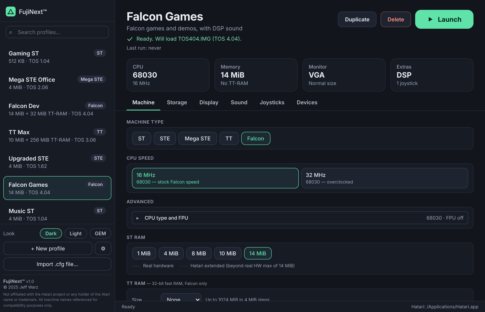
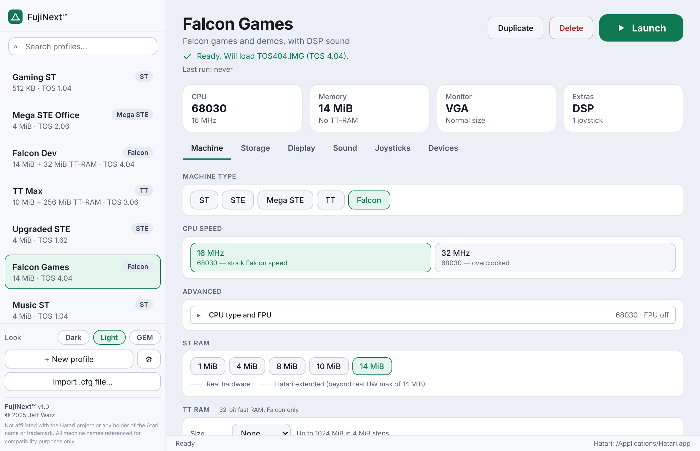
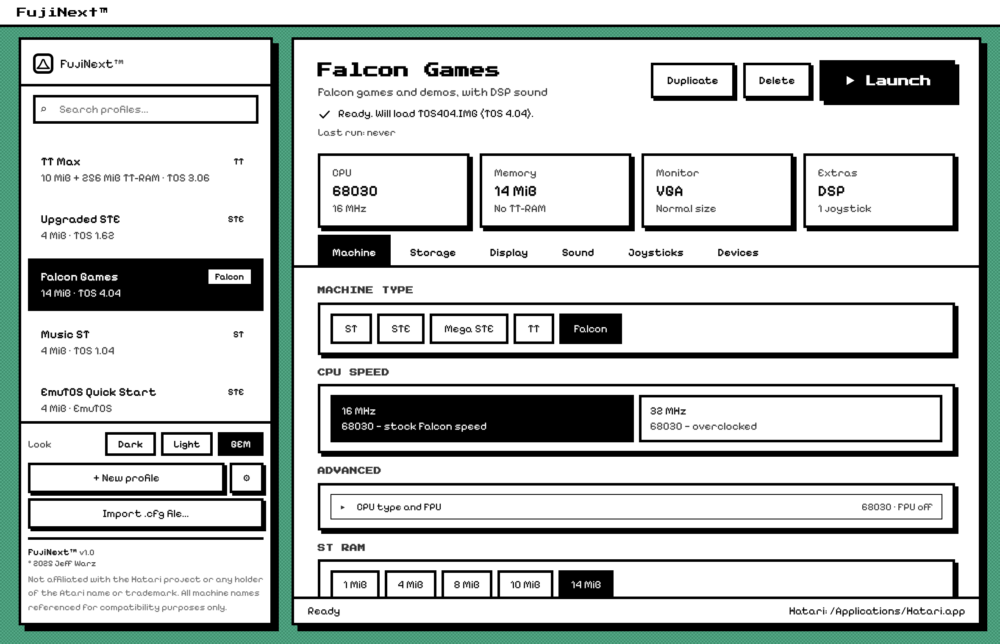

<p align="center">
  
</p>

# FujiNext™

**A friendly front end for the [Hatari](https://hatari.tuxfamily.org/) Atari ST emulator, for macOS and Windows.**

Pick a machine, point it at your disks, press **Launch**. No hunting through config files.

<p align="center">
  
</p>

[**Download the latest version**](https://github.com/Jeffwarz/FujiNext/releases) · [Website](https://jeffwarz.github.io/FujiNext/)

## What is FujiNext?

FujiNext is a small desktop app that sits in front of Hatari. You describe the Atari you want
(an ST with 1 MB and a floppy, a Falcon with a hard disk, a TT with lots of RAM) and FujiNext
saves that as a **profile**. Press **Launch** and Hatari starts with exactly those settings.

## Why does it exist?

Hatari is an excellent, very accurate emulator, but it is set up through a long list of command
line options and a settings file with hundreds of entries. That is great for experts, and a lot
to take in if you just want to boot a Falcon and play a demo.

FujiNext gives you:

- **Profiles**: one per setup, so switching from "Gaming ST" to "Falcon Dev" is one click.
- **Plain-English options** instead of config keys, with only the settings that matter for the chosen machine.
- **ROM detection**: point it at a folder of TOS ROMs and it works out which one fits each machine.
- **Looks you can change**: Dark, Light, or a chunky GEM-desktop style.

FujiNext never changes Hatari. It writes a separate config file for the profile you launch and
starts Hatari with `--configfile`, so your own Hatari settings are left alone.

## What can you set?

| Tab | Options |
|---|---|
| **Machine** | ST, STE, Mega STE, TT or Falcon. CPU speed. In *Advanced*: CPU type, FPU, ST RAM, TT RAM (TT and Falcon). TOS ROM (detected automatically, or choose your own). Switches for Blitter, DSP (Falcon) and the Timer-D patch. |
| **Storage** | Floppy drives A: and B:. Hard disks on ACSI, SCSI or IDE (with ID, or Master and Slave). A GEMDOS folder from your computer shown as a drive. Boot from hard disk. |
| **Display** | Monitor type. Fullscreen on launch, screen borders, double pixels for low resolution, aspect ratio correction. |
| **Sound** | Sound on or off and the playback sample rate. |
| **Joysticks** | All six ports (ST joystick 0 and 1, STE pads A and B, parallel-port sticks 1 and 2). Each can be Off, a game controller, or the keyboard. Auto-fire and "button 2 jumps" options. |
| **Devices** | Printer, serial port (RS232) and MIDI, each with an optional file to send to. |

### Extras

- **Ready-made profiles**: eight starting points, from a plain ST to a maxed-out TT and an EmuTOS quick start that needs no ROM at all. Use them as they are, or **Duplicate** one and make it yours.
- **Restore ready-made profiles**: in *Settings → Advanced*, or right-click a single profile. This only resets the ready-made ones; profiles you created, duplicated or imported are never touched.
- **Import a Hatari `.cfg`**: bring in an existing Hatari config and it becomes a profile.
- **Overview**: each profile shows a summary of its CPU, memory, DSP and monitor, and whether its ROM is found, before you launch.

## Getting started

1. **Install Hatari.** macOS: `brew install hatari` (or the app bundle). Windows: the official installer.
2. **Install FujiNext** from the [Releases page](https://github.com/Jeffwarz/FujiNext/releases).
   - **macOS** (Apple Silicon): open the `.dmg` and drag FujiNext to Applications. The app is not notarised yet, so the first time, right-click it and choose **Open** (or *System Settings → Privacy & Security → Open Anyway*).
   - **Windows**: run the installer. If SmartScreen warns you, choose **More info → Run anyway**.
3. Open **Settings**. FujiNext looks for Hatari in the usual places; browse to it if it isn't found. Optionally set your default ROM and disk folders.
4. Choose a ready-made profile (or make your own) and press **Launch**.

**About ROMs:** FujiNext doesn't include any Atari ROMs or software. The free [EmuTOS](https://emutos.sourceforge.io/) works on every machine with no extra file. For original TOS, supply your own ROM images; FujiNext will find them in your ROM folder.

Profiles and settings are saved as JSON in the app's data folder.

## Screenshots

<p align="center">
  
  
</p>

---

*For developers and maintainers:*

## Releasing

In GitHub, open **Actions → Release → Run workflow**, type a version such as `v1.0.0` and run it.
The macOS and Windows installers are attached to a draft release; check it, then press **Publish release**.

## Development

```bash
npm install
npm run tauri dev      # run the desktop app
npm test               # config generator tests
npx tsc --noEmit       # type-check
npm run tauri build    # installers for the current platform
```

Needs Node 22+, Rust (stable) and the [Tauri prerequisites](https://v2.tauri.app/start/prerequisites/).

## How it is put together

| Part | Where | Notes |
|---|---|---|
| UI | `src/components/` | React |
| Profile model | `src/types/profile.ts` | |
| Hatari config generator and importer | `src/hatari/config.ts` | The only place that knows Hatari's config format |
| Launching, detection, storage | `src-tauri/src/` | `platform.rs` has the OS-specific parts and its own unit tests |

### Keeping the config correct

Hatari silently ignores config keys it doesn't recognise, so a typo would just mean a setting
that doesn't work. To prevent that, `src/hatari/hatariKeys.json` is a snapshot of Hatari's real
keys and their types, extracted from its source, and the tests check every key and value the
generator writes against it.

When you move to a newer Hatari, refresh the snapshot and re-run the tests:

```bash
git clone https://github.com/hatari/hatari /tmp/hatari
python3 -I tools/extract-hatari-keys.py /tmp/hatari > src/hatari/hatariKeys.json
npm test
```

## Legal

FujiNext is released under the [MIT License](LICENSE). Copyright (c) 2026 Jeffwarz. FujiNext™ is a trademark of Jeffwarz.

FujiNext™ is an independent open source project and is not affiliated with, endorsed by, or
associated with the Hatari development team or its contributors. Hatari is a separate open source
Atari emulator developed independently. FujiNext™ is also not affiliated with or endorsed by any
current or former holders of the Atari name or intellectual property. All Atari machine names are
referenced for descriptive and compatibility purposes only.
